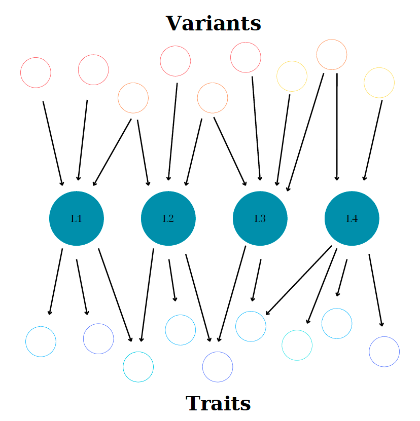

# Decomposing Genome–Phenome Associations Using Independent Component Analysis

**Master's Thesis | MSc in Data Science, University of Helsinki | May 2025**  
**Author:** Panagiotis Anastasakis  
**Supervisor:** Professor Matti Pirinen

*This is a summary of research that was conduxted at the Institute for Molecular Medicine Finland (FIMM), leading to a M.Sc. Thesis. For methodological details, simulation specifications, figures and complete results, please refer to the accompanying Thesis: **Decomposing Genome–Phenome Associations Using Independent Component Analysis** (University of Helsinki, 2025).*

## 1. Project Overview

Genome-wide association studies (GWASs) have identified large numbers of statistical associations between genetic variants and human traits. Interpreting these results is challenging due to the highly **polygenic** nature of complex traits, where many variants affect a given trait, each contributing a small effect. Additionally, **pleiotropy**, where a single variant can be associated with multiple traits, further complicates the identification of specific genetic pathways, requiring more elaborate statistical approaches for meaningful GWAS interpretations.

This project investigates methods for decomposing GWAS summary statistics (which capture variant-trait associations) from multiple studies, into lower-dimensional latent components. Each component represents a pattern of associations between a subset of genetic variants and a subset of phenotypes. The aim is to obtain more concentrated and interpretable representations of variant–trait relationships.

Two methods are implemented and evaluated:

- **DeGAs (Decomposition of Genetic Associations) [1]:** uses Singular Value Decomposition (SVD) to obtain latent components.
- **GUIDE (Genetic Unmixing by Independent Decomposition) [2]:** extends the DeGAs framework by applying Independent Component Analysis (ICA) to obtain statistically independent components.

The project also proposes a novel extension of GUIDE using **ICASSO**, which aggregates the results of repeated ICA runs to improve the stability and reliability of the estimated components. The methods are evaluated through extensive simulations under different genetic architectures, as well as through an application to a Type 2 Diabetes (T2D) GWAS summary-statistics dataset.

### Research objectives

The Thesis addresses four main objectives:

1. Implement DeGAs and GUIDE for decomposing variant–trait associations.
2. Improve GUIDE's robustness by integrating ICASSO to account for variability across ICA runs.
3. Compare the methods across simulated genetic architectures, including settings with different distributions, sparsity levels and model misspecification where an incorrect number of components is assumed.
4. Apply both methods to T2D GWAS data and assess the resulting components in terms of consistency, sparsity, independence and interpretability.

## 2. Methodological background

### GWAS summary statistics

A GWAS tests associations between genetic variants (typically single-nucleotide polymorphisms (SNPs)) and phenotypes. For a collection of variants and traits, the results can be organized into a matrix

$$
W \in \mathbb{R}^{n \times p},
$$

where rows correspond to genetic variants, columns correspond to phenotypes and each entry contains a summary statistic such as an effect-size estimate or a z-score. The patterns captured by the matrix can be rather complicated due to the polygenicity and pleiotropy surrounding variant-trait associations, making the extraction of useful information about subsets of variants or traits difficult. The goal of DeGAs and GUIDE is to deconvolute these associations by introducing latent components mediating variant-trait associations, which are easier to interpret.

### DeGAs: Singular Value Decomposition

DeGAs applies SVD to the standardized GWAS summary-statistics matrix:

$$
W = U\Sigma V^\mathsf{T}.
$$

The left and right singular vectors describe the contributions of variants and traits, respectively, while the singular values quantify the relative importance of the corresponding components. Retaining the first $L$ components gives a low-rank representation:

$$
W \approx U_L\Sigma_L V_L^\mathsf{T}.
$$

SVD provides an effective low-rank approximation, with components ordered by their singular values. Although the resulting components are orthogonal (hence, uncorrelated assuming they are mean centered), they are not necessarily statistically independent.

### GUIDE: Independent Component Analysis

GUIDE builds on the SVD representation by using Independent Component Analysis (ICA) to rotate the initial low-rank components into a representation whose components are more statistically independent. 

ICA is a form of blind source separation: the goal is to recover hidden source signals from observations that are mixtures of those sources, without knowing either the original signals or the mixing process in advance. A familiar illustration is the cocktail-party problem. Imagine several people speaking at the same time while multiple microphones record the room. Each microphone captures a different mixture of all the speakers. If the speakers' signals are statistically independent, ICA attempts to recover the individual voices from the recordings.

The general linear mixing model is:
$$
x = As,
$$

where:
- $s$ is a vector of unobserved source signals (the independent components).
- $A$ is an unknown mixing matrix describing how the sources are combined.
- $x$ is the vector of observed mixtures.
ICA estimates an unmixing matrix $D$ such that:

$$
\hat{s} = Dx
$$

contains estimates of the original sources. In practice, the algorithm does not know the true sources or the mixing matrix, it only has the observed data and relies on assumptions about the sources to estimate a useful separation.

In GUIDE, the same idea is applied to genetic association patterns rather than audio signals. The observed data are not recordings of voices: they are low-rank representations of GWAS variant–phenotype associations. ICA looks for a new linear combination of these patterns that separates them into components that are as statistically independent as possible. FastICA [3] was used for ICA estimation.

The resulting components can be interpreted through their variant and trait weights, where larger absolute weights indicate stronger contributions to a component. Since ICA components are identifiable only up to sign, scale and permutation, their ordering and signs require care when comparing results.

Figure 1 illustrates a hypothetical genetic architecture deconvoluted by DeGAs or GUIDE, comprising nine genetic variants, nine phenotypic traits and four underlying latent components.


*Figure 1: Illustration of the latent network connecting genetic variants and phenotypic traits through underlying components.*


### Improving robustness with ICASSO

A single ICA run may converge to a local optimum that captures only a subset of the underlying components, meaning that different random initializations can produce different decompositions. To address this issue, the Thesis introduces an extension of GUIDE that utilizes the ICASSO [4] methodology:

1. Run ICA multiple times using different initializations.
2. Aggregate all estimated component vectors from all runs.
3. Compute pairwise component similarities using absolute correlations.
4. Cluster similar components using agglomerative hierarchical clustering.
5. Represent each cluster by its medoid component.
6. Calculate the Cluster Quality Index (CQI) to assess cluster reliability, allowing to rank components by their importance.

The CQI reflects how compact a cluster is relative to its separation from other clusters. Higher values indicate more consistent component estimates across runs. This provides a novel measure of component reliability, which had not been available from the original GUIDE method.

## 3. Experimental design

### Simulation studies

Two simulation frameworks are used to compare GUIDE and DeGAs under controlled conditions.

** A. Block-structured architectures**

The first framework generates matrices with block-like patterns. Each block represents a latent component linking subsets of variants and traits. Dependencies between components are introduced through a parameter controlling the probability of additional non-zero weights outside the main blocks, which would imply that a variant or trait is loaded in multiple components. Noise is added to the component weights and to the resulting summary-statistics matrix. This framework makes it possible to examine how the methods behave as the underlying components become increasingly dependent.

** B. Polygenic additive architectures**

The second framework simulates genetic effects using a polygenic additive model, where multiple variants contribute to a given phenotype. Variant and trait weights are combined to generate the true effect-size matrix, consisting of z-scores. The weights are generated under two alternative distributional assumptions: a Gaussian distribution and a Laplace distribution. Different levels of sparsity are also considered for the summary statistics matrix, ranging from no sparsity to low and high sparsity, effectively introducing increasing complicated variant-trait networks. Sampling variability is introduced through standard errors and the resulting matrix is used as input to the decomposition methods.

Because the true simulated components are known, estimated components can be matched to the ground truth using their correlations. This allows the recovery performance of GUIDE and DeGAs to be compared quantitatively.

### Type 2 Diabetes application

The real-data analysis uses a T2D GWAS summary-statistics dataset constructed by Smith et al. (2024) [5]. The dataset contains:

- **650 T2D-associated genetic variants**
- **110 quantitative phenotypes related to T2D**
- A **650 × 110** matrix of z-scores

The dataset was assembled from GWASs across multiple ancestral populations. Its preprocessing included variant filtering, linkage-disequilibrium pruning, trait selection, sample-size scaling and imputation of remaining missing entries. Further details of the original data-processing pipeline are available in the cited Smith et al. study.

This dataset was first analyzed with another factorization method, called bayesian Non-Negative Matrix Factorization (bNMF). The results of this analysis are compared with those from running GUIDE and DeGAs, initialized with 12 components, same as those bNMF was ran with. The ICASSO-extended GUIDE implementation used 100 ICA runs per decomposition.

## 4. Main findings

### Simulation results

The simulation studies show that GUIDE can recover the underlying genetic architecture more accurately than DeGAs in settings where the ICA assumptions are appropriate.

- GUIDE performs better when the underlying weights follow a Laplace distribution or are highly sparse Gaussian. This is because ICA assumes that the underlying components are non-Gaussian.
- When the weights are Gaussian with little or no sparsity, GUIDE and DeGAs perform similarly. In these settings, the ICA step offers little additional benefit because it fails to identify purely Gaussian independent components.
- GUIDE's performance deteriorates when the number of components is overestimated, as including unnecessary dimensions can introduce noise and make ICA estimation less reliable. In contrast, DeGAs is more robust to overestimation, since additional SVD components capture progressively smaller amounts of variation without altering the previously estimated components.
- CQI scores can help prioritize meaningful components in some simulation settings, particularly when the underlying weights are sparse.


### Type 2 Diabetes results

GUIDE was ran with the proposed ICASSO extension in the T2D data. It is found that GUIDE components closely align with components identified in the original bNMF analysis, providing evidence that GUIDE can recover meaningful patterns in the T2D association data. The results also demonstrate that individual ICA runs, as originally proposed in GUIDE, can yield inconsistent subsets of components. Integrating ICASSO substantially improves consistency across repeated GUIDE decompositions.

Although bNMF provided informative T2D components, it is constrained to non-negative variant weights. In contrast, GUIDE can capture both positive and negative weights, allowing it to reveal additional structure in variant–trait association patterns.

Compared with DeGAs, GUIDE produced components that are:

- **Sparser**, with stronger weights concentrated in fewer variants and traits.
- **More independent**, with less overlap between components.
- **More concentrated**, capturing more distinct patterns of variant–trait associations.

These properties can make the components easier to interpret, potentially providing clearer insights into the underlying biological mechanisms of T2D.

## 5. Limitations and future directions

GUIDE relies on the ICA assumption that the latent components are statistically independent and non-Gaussian. These assumptions may not hold for every genetic architecture. Strongly overlapping biological mechanisms or Gaussian latent signals can reduce the suitability of ICA and may lead to misleading decompositions.

The number of components also requires careful consideration. Overestimating it can cause ICA to split underlying signals and reduce recovery accuracy. Although ICASSO improves stability and provides CQI-based ranking, selecting the optimal number of components remains an open methodological question.

Potential directions for further work include:

- Developing diagnostic procedures to identify violations of ICA assumptions.
- Investigating principled component number selection strategies using ICASSO and CQI.
- Quantitatively comparing GUIDE and bNMF component overlap.
- Evaluating the methods across additional simulated and real genetic datasets.

## References

1. **Tanigawa, Y. et al. (2019).** *Components of genetic associations across 2,138 phenotypes in the UK Biobank highlight adipocyte biology.* Nature Communications, 10, 4064.
2. **Lazarev, D., Chau, G., Bloemendal, A., Churchhouse, C., & Neale, B. M. (2024).** *GUIDE deconstructs genetic architectures using association studies.* bioRxiv.
3. **Hyvärinen, A. (1999).** *Fast and robust fixed-point algorithms for independent component analysis.* IEEE Transactions on Neural Networks, 10(3), 626–634.
4. **Himberg, J., Hyvärinen, A., & Esposito, F. (2004).** *Validating the independent components of neuroimaging time series via clustering and visualization.* NeuroImage, 22(3), 1214–1222.
5. **Smith, K. et al. (2024).** *Multi-ancestry polygenic mechanisms of type 2 diabetes.* Nature Medicine, 30, 1065–1074.


## Repository Structure

```
DeGAs-GUIDE/
├── scripts/
│   ├── Additional_helper_functions.R
│   ├── Block_simulation.Rmd
│   ├── DeGAs.R
│   ├── Example_usage.R
│   ├── GUIDE.R
│   ├── Polygenic_simulation_1.Rmd
│   ├── Polygenic_simulation_2.Rmd
│   ├── Polygenic_simulation_3.Rmd
│   ├── Simulation_functions.R
│   ├── T2D_Data_Analysis.R
│   └── bNMF.R
├── .DS_Store
├── .gitignore
├── GUIDE.Rproj
├── README.md
└── Thesis.pdf
```

*`Additional_helper_functions.R`: Contains additional functions used throughout this work.
*`Block_simulation.Rmd`, `Polygenic_simulation_1.Rmd`, `Polygenic_simulation_2.Rmd` and `Polygenic_simulation_3.Rmd`: Contain the full simulation pipeline, including data generation, storage and visualization of results.
*`DeGAs.R`: Implements DeGAs.
*`Example_usage.R`: Provides a simple example demonstrating how one can use this implementation of GUIDE and DeGAs.
*`GUIDE.R`: Implements GUIDE, extended with ICASSO.
*`Simulation_functions.R`: Contains helper functions for generating simulated data and conducting the simulation experiments.
*`T2D_Data_Analysis.R`: Contains the analysis of the Type 2 Diabetes (T2D) dataset using the implemented decomposition methods.
*`bNMF.R`: Contains functions for running bNMF, originating from [this](https://github.com/gwas-partitioning/bnmf-clustering) repository. The implementation of bNMF is not part of this work, but may be included in future analyses.
*`Thesis.pdf`: Contains the full thesis, including the theoretical background, methodology, experimental results and conclusions.


**Data Availability and Reproducibility:** The T2D analysis uses data from Smith et al. (2024) [5]. Users should obtain the dataset from its original source and follow the source's access and data-use conditions. The Thesis does not include the underlying individual-level genetic data.


